# Model Unlearning — Data Identification Experiment

Can we tell **target** records from **forget** records after training a small LoRA adapter on a subset of the target class?

This repo implements a diagnostic pipeline that tests two scoring signals — a **perplexity ratio** (base GPT-2 vs LoRA-adapted GPT-2) and an **embedding similarity** score (LoRA hidden states) — across four **same-domain** dataset pairs. LoRA is trained on an actively selected 20% of target rows; all metrics are computed on a held-out eval set (remaining target + all forget). Strict leakage audits run before every training step.

> 📘 **New to the concepts, or deciding what to run next?** See [`explanation.md`](explanation.md)
> — plain-language explanations of PU learning, nnPU, BADGE, diversity/coreset,
> QBC and the baselines, plus an honest read of the current results and two
> concrete plans for the next experiment.

---

## Table of contents

- [Experiment design](#experiment-design)
- [Quick start](#quick-start)
- [Pipeline overview](#pipeline-overview)
- [Scoring methods](#scoring-methods)
- [Overlap estimators (Active-PU pipeline)](#overlap-estimators-active-pu-pipeline)
- [Active nnPU & full method comparison](#active-nnpu--full-method-comparison)
- [Code walkthrough](#code-walkthrough)
- [Example results (Q1 — Math)](#example-results-q1--math)
- [Cross-quadrant summary](#cross-quadrant-summary)
- [Configuration](#configuration)
- [Project layout](#project-layout)
- [Leakage controls](#leakage-controls)
- [Length matching (`download.py`)](#length-matching-downloadpy)
- [Caveats](#caveats)

---

## Experiment design

Each quadrant pairs two datasets from the **same broad domain** so that text length or surface format cannot trivially separate classes. Every combined JSON record has:

```json
{ "id": "...", "source": "gsm8k", "text": "...", "quadrant_label": 1, "role": "target" }
```

`quadrant_label = 1` → target (LoRA training source), `0` → forget (never trained on).

| Q | Domain | Target (`label=1`) | Forget (`label=0`) | Large scale (≈) |
|---|--------|--------------------|--------------------|-----------------|
| Q1 | Math word problems | GSM8K (train+test) | SVAMP + ASDiv + hendrycks_math | **~4k** |
| Q2 | Python code | HumanEval + CodeSearchNet (doc+code) | MBPP + CSN code-only (disjoint) | **~4k** |
| Q3 | Extractive QA | SQuAD | NQ-open | ~6k |
| Q4 | Short news | AG News | XSum summaries | ~6k |

Q1/Q2 are sized ≥3000 combined so Active-PU has real `U_pool`s (~1600). Forget pads are chosen to keep **length-AUROC ≈ 0.50** (Q2 forget uses code-only CSN so it is not a clone of the target docstring+code pad). Backbone: **GPT-2 Medium**, LoRA `r=16`, `TRAIN_EPOCHS=3`, `MAX_SEQ_LEN=256`.

**Train / eval split**

- **Train (20% of target):** chosen by active learning (uncertain + diverse), not random.
- **Eval:** all forget rows + held-out target rows (80% of target).
- **Positive class for metrics:** held-out target (`label=1`) vs forget (`label=0`).

---

## Quick start

```bash
pip install -r requirements.txt

# Build length-matched quadrants (default = large Active-PU scale)
DATA_SCALE=large python download.py          # ~0.7k–5k rows / quadrant
# DATA_SCALE=small python download.py        # legacy compact sizes

# Full pipeline after a data rebuild (old checkpoints are invalid)
rm -rf checkpoints/q*_  checkpoints/shadows results/*_pu_features.npz results/*_comparison.json
python experiments/run_identification.py                              # train LoRAs
python experiments/run_overlap_scorers.py --with-lira --train-shadows  # shadows + scores
python experiments/run_active_pu.py --rebuild-cache                    # Active-PU comparison
```

Requires Python 3.10+, PyTorch, and optionally CUDA. Checkpoints skip re-training if `checkpoints/q{n}_*_r20_s42_e1/` already exists — **delete them after changing `DATA_SCALE` or `download.py` knobs**.

Expected Active-PU split sizes under `DATA_SCALE=large` (≈):

| Quadrant | Combined | ≈P | ≈U_pool | ≈U_test |
|----------|---------:|---:|--------:|--------:|
| Q1 Math | 710 | 71 | 284 | 284 |
| Q2 Code | 1632 | 163 | 653 | 653 |
| Q3 QA | 4714 | 471 | 1886 | 1886 |
| Q4 News | 5326 | 533 | 2130 | 2130 |

---

## Pipeline overview

```
data/quadrants/q{n}/*_combined.json
        │
        ▼
  load_quadrant()                    ← src/data_loader.py
        │
        ▼
  gather_selection_inputs()          ← src/sample_select.py (base GPT-2 only)
        │   embeddings, loss, entropy, grad_norm
        ▼
  make_informative_split()           ← k-means diversity + max-uncertainty per cluster
        │
        ▼
  audit_split()                      ← zero overlap on idx, (source,id), text
        │
        ▼
  train_lora()                       ← src/lora_trainer.py (target rows only)
        │
        ├──────────────────────────────────┐
        ▼                                  ▼
  compute_ppl_ratio_scores()      compute_embedding_scores()
        │                                  │
        └──────────┬───────────────────────┘
                   ▼
        compute_combined_scores()    ← 0.4·PPL + 0.6·emb (min-max)
                   │
        ┌──────────┼──────────┐
        ▼          ▼          ▼
  compute_all_metrics()   plot_all()   run_layerwise_drift()
        │                                  │
        ▼                                  ▼
  results/*.json              plots/{qid}/*.png
```

Driver: [`experiments/run_identification.py`](experiments/run_identification.py) loops `q1`…`q4`, saves JSON artifacts, prints a metrics table and an observations block at the end.

---

## Scoring methods

| Method | Formula / definition | Higher score means… |
|--------|----------------------|---------------------|
| **PPL ratio** | `log(PPL_base + ε) − log(PPL_lora + ε)` | LoRA fits the row better than base |
| **Embedding** | `cos(h_lora(x), centroid)` where `h` is mean-pooled last-layer LoRA hidden state; centroid = normalized mean of train-subset embeddings | Closer to the LoRA train distribution |
| **Combined** | `0.4 · minmax(PPL) + 0.6 · minmax(emb)` on the eval set | Better trade-off of both signals |

Implementation: [`src/scorer.py`](src/scorer.py). Embedding uses **LoRA GPT-2 hidden states only** — no separate sentence-transformer — so embedding scores and layerwise drift read from the same representation stream.

**Metrics** ([`src/metrics.py`](src/metrics.py)): AUROC, average precision, best F1 (threshold sweep), Kolmogorov–Smirnov statistic, Cohen's d, KDE overlap coefficient, precision@K for K ∈ {10, 25, 50, 100}. Results written to `results/{qid}_{name}_metrics.json`.

---

## Overlap estimators (Active-PU pipeline)

Beyond the two identification signals above, [`src/overlap_scorers.py`](src/overlap_scorers.py) implements **five independent overlap estimators** for the Active Positive-Unlabeled (PU) formulation of target–forget separation. Each maps a text to a single scalar — *how target-like is `x` after LoRA adaptation* — with **no feature fusion**, so the same PU framework can later be run once per estimator and compared fairly.

### Leakage-free three-way split

The classic 20/80 split leaks when the PU **positive set** is the same data the adapter memorised. [`make_pu_split`](src/data_loader.py) partitions the target class three ways:

| Split | Role |
|-------|------|
| `lora_train` | adaptation **only** — fits the LoRA adapter |
| `P` (positives / reference) | labeled positives + embedding centroid; **disjoint** from `lora_train` |
| `held-out target` | hidden positives, placed in the unlabeled pool `U` |

All forget rows join `U`. Scores are computed on `P ∪ U`, none of which are in `lora_train`, so the adapter never memorised any scored row. Passing `lora_train_keys` (read from an existing checkpoint's `split_info.json` via `load_train_keys`) keeps the split consistent with an already-trained adapter — **no retraining required**.

### Estimators

| Estimator | Statistic (higher ⇒ more target-like) | Needs shadows? |
|-----------|----------------------------------------|:--:|
| `ppl_ratio` | mean-token `logp_LoRA(x) − logp_base(x)` | no |
| `minkpp` | Min-K%++ gap: mean of the calibrated bottom-`MINK_FRAC` token scores `z_t = (logp − μ_t)/σ_t` (vocab mean/std), LoRA minus base | no |
| `embedding` | `cos(h_LoRA(x), centroid_P)` — centroid built from the `P` reference pool | no |
| `lira_lite` | ensemble OUT-shadow benefit `mean_{s: x∉train(s)} (base_nll − shadow_nll)` — a variance-reduced PPL ratio | yes |
| `lira_full` | OUT-calibrated Gaussian gap `(s_ref − μ_out)/σ_out`, `s_ref` = mean IN-shadow benefit (memorisation) when available, else the main adapter | yes |

LiRA references come from `LIRA_N_SHADOWS` shadow adapters trained on random `LIRA_SHADOW_FRAC` subsets of the target class ([`src/shadow_lora.py`](src/shadow_lora.py)). Because every `U` row is a non-member of the main adapter, a classic observed-vs-OUT LiRA is confounded by adapter strength; the estimators above key membership off the shadows instead.

### Run

Prerequisite: LoRA checkpoints from `run_identification.py` must exist (the scorer reuses them; it does not retrain the main adapter).

```bash
# Full pipeline, all quadrants, all five estimators incl. leak-free LiRA
# (trains 8 shadow adapters per quadrant the first time)
python experiments/run_overlap_scorers.py --with-lira --train-shadows

# Training-free estimators only (PPL ratio, Min-K++, embedding)
python experiments/run_overlap_scorers.py                       # all quadrants
python experiments/run_overlap_scorers.py --quadrants q2        # one quadrant

# Reuse already-trained shadows (skip --train-shadows)
python experiments/run_overlap_scorers.py --with-lira
```

Offline / air-gapped hosts can skip Hugging Face network stalls with a local snapshot:

```bash
BASE_MODEL_OVERRIDE=/path/to/hf/hub/models--openai-community--gpt2/snapshots/<hash> \
HF_HUB_OFFLINE=1 python experiments/run_overlap_scorers.py --with-lira --train-shadows
```

Shadow adapters land in `checkpoints/shadows/`; delete them to force a clean retrain. Per-quadrant metrics (AUROC, AUPRC, F1, precision, recall, FPR@95TPR, best-F1 threshold) plus the 3-way split sizes are written to `results/{qid}_{name}_overlap_scores.json`.

### Results

Separability on `U` (held-out target vs forget), best-F1 threshold for F1/Prec/Rec:

Separability on `U` (held-out target vs forget), best-F1 threshold for F1/Prec/Rec. Full leak-free sweep (shadows trained only on `lora_train ∪ P`, `U∩shadow-train = 0`):

| Quadrant | Estimator | AUROC | AUPRC | F1 | Prec | Rec | FPR@95 |
|----------|-----------|:-----:|:-----:|:--:|:----:|:---:|:------:|
| **Q1 Math** | ppl_ratio | 0.683 | 0.673 | 0.573 | 0.520 | 0.639 | 0.942 |
| | minkpp | 0.549 | 0.380 | 0.567 | 0.427 | 0.843 | 0.905 |
| | embedding | 0.610 | 0.557 | 0.566 | 0.399 | 0.976 | 0.876 |
| | lira_lite | **0.724** | 0.723 | 0.629 | 0.750 | 0.542 | 0.847 |
| | lira_full _(baseline)_ | 0.227 | 0.256 | 0.548 | 0.377 | 1.000 | 1.000 |
| **Q2 Code** | ppl_ratio | 0.823 | 0.692 | 0.725 | 0.602 | 0.909 | 0.549 |
| | minkpp | 0.594 | 0.578 | 0.583 | 0.425 | 0.927 | 0.835 |
| | **embedding** | **0.852** | **0.798** | 0.748 | 0.769 | 0.727 | 0.626 |
| | lira_lite | 0.788 | 0.627 | 0.699 | 0.568 | 0.909 | 0.582 |
| | lira_full _(baseline)_ | 0.818 | 0.669 | 0.758 | 0.649 | 0.909 | 0.637 |
| **Q3 QA** | ppl_ratio | 0.809 | 0.742 | 0.675 | 0.630 | 0.727 | 0.674 |
| | **minkpp** | **0.879** | **0.840** | 0.758 | 0.754 | 0.762 | 0.540 |
| | embedding | 0.832 | 0.721 | 0.708 | 0.610 | 0.843 | 0.560 |
| | lira_lite | 0.825 | 0.756 | 0.686 | 0.663 | 0.710 | 0.621 |
| | lira_full _(baseline)_ | 0.396 | 0.319 | 0.545 | 0.375 | 1.000 | 0.970 |
| **Q4 News** | ppl_ratio | 0.781 | 0.731 | 0.673 | 0.691 | 0.656 | 0.904 |
| | minkpp | 0.632 | 0.562 | 0.547 | 0.436 | 0.734 | 0.978 |
| | embedding | 0.578 | 0.452 | 0.547 | 0.377 | 1.000 | 0.937 |
| | **lira_lite** | **0.787** | **0.740** | 0.687 | 0.694 | 0.680 | 0.889 |
| | lira_full _(baseline)_ | 0.357 | 0.293 | 0.546 | 0.376 | 1.000 | 0.988 |

No single estimator wins everywhere: embedding leads on code (Q2), Min-K++ dominates QA (Q3), and PPL ratio / `lira_lite` are the most robust across domains. These per-sample scores are the **input representation** for the Active-PU classifier (below), evaluated one estimator at a time.

> **`lira_full` is a baseline, not the main method — its orientation flips across datasets.** Leak-free AUROC is 0.227 (Q1), 0.818 (Q2), 0.396 (Q3), 0.357 (Q4): forget scores *higher* than target in 3 of 4 quadrants. After the leakage fix (shadows restricted to `lora_train ∪ P`, IN branch never fires for `U`), `lira_full` reduces to normalising the weak main-adapter benefit by a per-example OUT-shadow σ that is near-degenerate for forget rows (σ hits its floor, amplifying tiny sign-unstable differences). The Q2 score is also numerically unstable (0.985 → 0.818 on rerun). We therefore keep **`lira_lite`** (ensemble OUT benefit; stable, oriented in all four quadrants) as the LiRA baseline and drop `lira_full` to a reference point. `minkpp` is leak-free by construction (base + LoRA forwards on `U` only).
>
> **Earlier leakage (now fixed).** A prior version trained shadows on *all* target rows, so held-out target rows in `U` landed in shadow training sets and `lira_full`'s IN branch read the ground-truth label. The runtime `U ∩ shadow-train = 0` assertion prevents any recurrence.

---

## Active nnPU & full method comparison

The **main method** ([`src/active_pu.py`](src/active_pu.py), driver [`experiments/run_active_pu.py`](experiments/run_active_pu.py)) frames target–forget separation as Positive-Unlabeled learning and improves it with active labeling and negative mining — directly aligned with estimating target–forget *overlap*. The same driver runs it against a full ladder of baselines so every claim is measured against a control.

### Method roster

| Method | Type | Classifier | Acquisition | Labels used |
|--------|------|------------|-------------|-------------|
| `raw_*` (one per estimator) | detector | none | none | 0 |
| `naive_pn` | PU | logistic (U treated as negative) | none | `P` only |
| `pu_static_linear` | PU | nnPU, linear head | none | `P` only |
| `pu_static_mlp` | PU | nnPU, 1-hidden MLP | none | `P` only |
| `active_random` | active | nnPU, linear | random (passive baseline) | `P` + budget |
| `active_uncertainty` | active | nnPU, linear | margin `1−\|2p−1\|` | `P` + budget |
| `active_diversity` | active | nnPU, linear | k-center / coreset (cosine) | `P` + budget |
| `active_badge` | active | nnPU, linear | gradient-embedding k-means++ | `P` + budget |
| `active_committee` | active | nnPU, linear | QBC estimator disagreement | `P` + budget |
| `active_uxd` | active | nnPU, linear | Uncertainty × Diversity | `P` + budget |
| `supervised_skyline` | ceiling | logistic on the **fully-labeled** U-pool | — | `P` + all U-pool |

### Pipeline (proposal Stages 3–7)

1. **nnPU (Stage 3).** Non-negative PU risk (Kiryo et al., 2017) with the sigmoid surrogate, trained on positives `P` and unlabeled `U_pool` with a re-estimated prior π each round. `PUNet` is linear (`PU_HIDDEN=0`, default) or a 1-hidden-layer MLP. **Retrained from scratch every round** (`init_seed = seed + round`).
2. **Active acquisition (Stage 4).** Queried rows are **removed** from `U_pool` and added to the labeled set (positives or confirmed negatives). Uncertainty uses **sigmoid probabilities** (`1−|2p−1|`), not raw logits.
3. **Reliable negatives (Stage 5).** The lowest-probability tail of the remaining pool becomes soft negatives for the final head.
4. **Hard negatives (Stage 6).** Acquired forget rows that scored highly sit on the overlap boundary.
5. **Final classifier (Stage 7).** Calibrated logistic + isotonic on labeled + reliable negatives. **Reported metric for active methods.** Static PU (`pu_static_*`) reports **round-0 nnPU** on `U_test` instead — Stage 7's reliable-negative bootstrap *hurts* when no negatives have been acquired (0.925 → 0.650 on Q3).

### Active-PU loop audit (all checks pass)

Run `python experiments/run_active_pu.py --audit --quadrants q2` to verify:

| Check | Status |
|-------|--------|
| Queried samples removed from `U_pool` | ✓ `unlabeled.discard(j)` each round |
| Labeled set grows and is used in retraining | ✓ `n_labeled` increases; `p_ids`/`n_ids` fed to `train_nnpu` |
| Model retrained from scratch each round | ✓ new `PUNet` + `init_seed=seed+round` |
| Uncertainty from probabilities (margin / entropy) | ✓ `pu_proba` → `1−\|2p−1\|` |
| Prior updated each round | ✓ `_estimate_prior()` from remaining hidden positives in pool |
| Features z-scored on train rows only (never `U_test`) | ✓ `_standardize_train(P∪labeled∪remaining pool)` per round |

### Evaluation protocol & leakage discipline

The unlabeled pool `U` is split once (stratified, `SPLIT_SEED`, shared by every method and seed) into:

| Slice | Role |
|-------|------|
| `U_pool` (50%) | acquirable pool — nnPU unlabeled inputs, acquisition, reliable-negative mining |
| `U_test` (50%) | **held out** — never trained on, never unlabeled input, never acquired |

**Every metric is computed on `U_test` only.** Upstream: LoRA trains only on `lora_train`; `emb_cos` centroid from `P` only; `lira_lite` asserts `U∩shadow-train=0`; PPL/Min-K++ are forward-only on unscored rows.

### Classifier features — overlap scores, not the raw embedding

The classifier input is `[ppl_ratio, minkpp, emb_cos, lira_lite]` (`PU_SCORE_COLS`). The 768-d LoRA embedding is used **only** for diversity/coreset acquisition. Cached to `results/{qid}_{name}_pu_features.npz`.

### Run / reproduce

```bash
# 0) prerequisites (once)
python experiments/run_identification.py
python experiments/run_overlap_scorers.py --with-lira --train-shadows

# 1) audit the active loop (optional)
python experiments/run_active_pu.py --audit --quadrants q2

# 2) full comparison — all quadrants, 13 methods, 5 seeds
python experiments/run_active_pu.py

# variants
python experiments/run_active_pu.py --quadrants q2 --seeds 10
python experiments/run_active_pu.py --no-lira
python experiments/run_active_pu.py --rebuild-cache   # force feature re-extraction
```

Offline: `BASE_MODEL_OVERRIDE=/path/to/gpt2/snapshot HF_HUB_OFFLINE=1 python experiments/run_active_pu.py`

**Outputs:** `results/{qid}_{name}_comparison.json`, `results/comparison_summary.{json,md}`, and plots under `plots/comparison/`:

| Plot | What it shows |
|------|---------------|
| `{qid}_label_efficiency.png` | Per-round nnPU (solid), fixed-init (dashed), warm-start (dotted), Stage-7 ★ |
| `{qid}_init_mode_comparison.png` | 6-panel: init-mode curves per acquisition strategy |
| `{qid}_active_dual_metrics.png` | Grouped bars: last nnPU vs Stage-7 final |
| `{qid}_method_ranking.png` | All methods ranked by AUROC |
| `comparison_auroc_heatmap.png` | Methods × quadrants heatmap |
| `comparison_active_head_to_head.png` | Active strategies: last nnPU vs Stage-7 |
| `comparison_best_per_quadrant.png` | Best-of-family bars per quadrant |

Active methods report **two** AUROC scores in JSON/console: `last_nnpu` (end-of-loop nnPU) and `stage7_final` (calibrated logistic). The master table uses Stage-7; see the dual table in `comparison_summary.md`.

### Results — held-out `U_test`, mean ± std over 5 seeds

Full tables for AUROC / AUPRC / F1 / Prec / Rec / FPR@95: [`results/comparison_summary.md`](results/comparison_summary.md).

**AUROC master table:**

| Method | Type | Q1 Math | Q2 Code | Q3 QA | Q4 News |
|--------|------|:-------:|:-------:|:-----:|:-------:|
| raw ppl_ratio | detector | 0.735 | 0.845 | 0.822 | 0.790 |
| raw minkpp | detector | 0.562 | 0.563 | **0.884** | 0.643 |
| raw emb_cos | detector | 0.583 | **0.898** | 0.836 | 0.578 |
| raw lira_lite | detector | 0.767 | 0.812 | 0.837 | **0.800** |
| naive_pn | PU | 0.806 | 0.858 | 0.916 | 0.777 |
| pu_static_linear | PU | 0.720 | 0.851 | **0.925** | 0.791 |
| pu_static_mlp | PU | **0.811** | 0.852 | 0.915 | 0.773 |
| active_random | active | 0.787 | 0.863 | 0.921 | 0.781 |
| **active_uncertainty** | active | 0.811 | **0.923** | 0.881 | 0.707 |
| active_diversity | active | 0.804 | 0.836 | 0.913 | **0.785** |
| active_badge | active | 0.805 | 0.898 | 0.912 | 0.767 |
| active_committee | active | 0.792 | 0.907 | 0.915 | **0.785** |
| active_uxd | active | 0.807 | 0.878 | 0.896 | 0.709 |
| supervised_skyline | ceiling | **0.844** | 0.885 | **0.930** | 0.784 |

**Condensed best-of-family (AUROC):**

| Quadrant | Best raw | naive PN | Static nnPU | **Active PU (best)** | Skyline |
|----------|:--------:|:--------:|:-----------:|:--------------------:|:-------:|
| Q1 Math | 0.767 | 0.806 | 0.811 (mlp) | 0.811 | **0.844** |
| Q2 Code | 0.898 | 0.858 | 0.851 | **0.923** | 0.885 |
| Q3 QA | 0.884 | 0.916 | **0.925** | 0.921 | **0.930** |
| Q4 News | 0.800 | 0.777 | 0.791 | 0.785 | 0.784 |

**Q3 QA — full metrics** (`P=156, U_pool=622, U_test=622, budget=12`; best active in bold)

| Method | AUROC | AUPRC | F1 | Prec | Rec | FPR@95 |
|--------|:-----:|:-----:|:--:|:----:|:---:|:------:|
| raw minkpp | 0.884 | 0.845 | 0.771 | 0.777 | 0.764 | 0.527 |
| naive_pn | 0.916 | 0.870 | 0.815 | 0.815 | 0.815 | 0.409 |
| **pu_static_linear** | **0.925** | 0.878 | 0.815 | 0.782 | 0.852 | 0.346 |
| pu_static_mlp | 0.915 | 0.868 | 0.804 | 0.774 | 0.837 | 0.391 |
| active_random | 0.921 | 0.844 | 0.808 | 0.782 | 0.842 | 0.502 |
| active_committee | 0.915 | 0.817 | 0.815 | 0.826 | 0.805 | 0.466 |
| active_diversity | 0.913 | 0.811 | 0.810 | 0.789 | 0.835 | 0.351 |
| active_uncertainty | 0.881 | 0.774 | 0.741 | 0.709 | 0.835 | 0.482 |
| supervised_skyline | 0.930 | 0.891 | 0.828 | 0.831 | 0.824 | 0.344 |

### What the comparison shows

- **Static nnPU works** when reported as round-0 scores (Q3 **0.925**, Q2 **0.851**). The earlier "collapse" was a Stage-7 reporting artifact, not broken nnPU optimization.
- **Skyline is a genuine ceiling** — active PU never exceeds it (Q3: 0.921 vs 0.930; Q2: 0.923 vs 0.885 within noise on 73-row test).
- **Active labeling helps via acquired negatives + calibrated final head**, especially when static nnPU alone is insufficient (Q1: static 0.72 → active 0.81; Q4: uncertainty-only hurts at 0.71).
- **`naive_pn` remains a strong control** (Q3 0.916) but treats the entire pool as negative; active methods match it with far fewer true labels.
- **Uncertainty-only is unstable** on Q4 (AUROC 0.71, FPR@95 0.97) — over-sampling the ambiguous overlap region injects label noise.

### Label efficiency & dual metrics

Per-round curves now show three init modes plus the Stage-7 endpoint (★):

- **Solid** — fresh random init each round (default; can dip mid-run from init noise)
- **Dashed** — fixed `init_seed` across rounds (smoother, monotonic-ish)
- **Dotted** — warm-start from previous round's weights
- **★** — Stage-7 calibrated final at max label budget

Q4 (shows Stage-7 hurting uncertainty on overlap-heavy news):

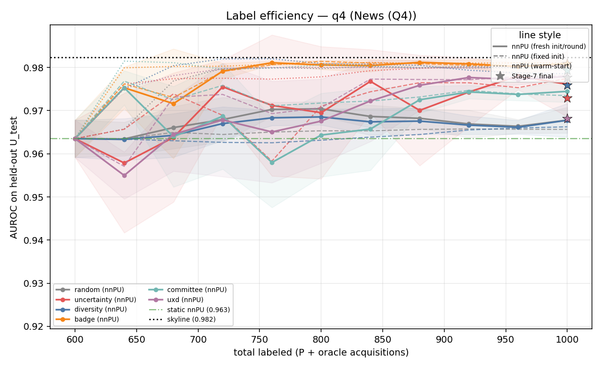

Init-mode panels (Q4):

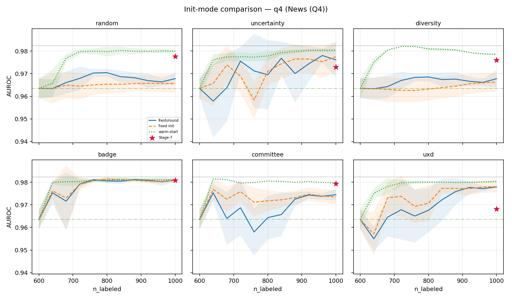

Active dual metrics — last nnPU vs Stage-7 (Q4):

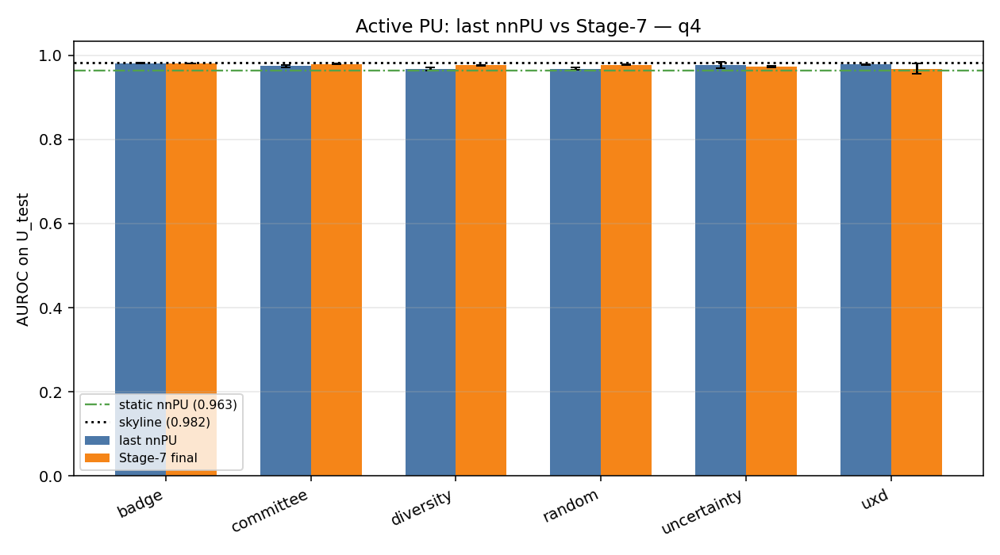

Cross-quadrant heatmap:

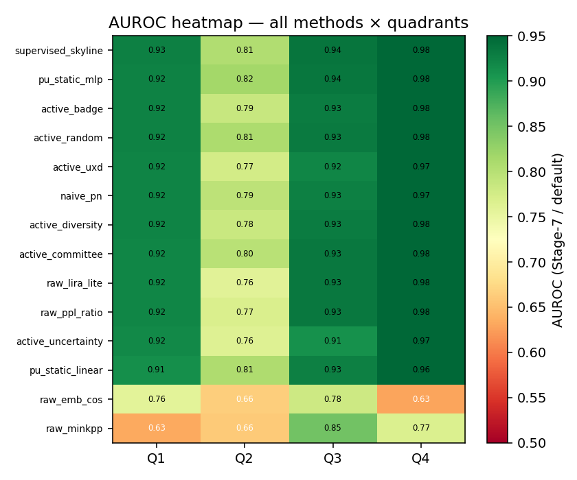

---

## Code walkthrough

### `config.py`

Central paths (`DATA_QUAD`, `CHECKPOINTS`, `RESULTS`, `PLOTS`) and hyperparameters: `BASE_MODEL = openai-community/gpt2-medium`, `MAX_SEQ_LEN = 256`, LoRA `r=16, α=32`, `SPLIT_RATIO = 0.2`, `SPLIT_SEED = 42`, `TRAIN_EPOCHS = 3`. The `QUADRANTS` dict maps each `qid` to its directory name and display label.

### `download.py`

Builds `data/raw/*.json` from Hugging Face datasets and assembles matched quadrants under `data/quadrants/`. For each pair:

1. Truncate text to per-pair caps (`TRUNC`: 200 / 400 / 150 / 200 chars).
2. Drop stubs below `LOWER` character bounds (`q1` 60, `q2` 80, `q3` 40, `q4` 80).
3. Restrict both classes to the **length overlap band** `[max(min_t, min_f), min(max_t, max_f)]`.
4. **Stratified bin sampling** — equal target/forget counts per narrow length bin (`N_BINS_PER`).
5. Print **length-only AUROC** as a sanity check (should be ≈ 0.5).

Q4 forget uses **XSum summaries** instead of Reuters-21578 (deprecated HF script); length is still matched.

### `src/data_loader.py`

- **`load_quadrant(qid)`** — loads `{name}_combined.json`, validates columns `id, source, text, quadrant_label, role`, prints class counts and mean text length.
- **`make_informative_split(df, target_signals)`** — maps active-learning indices back to DataFrame positions; eval = held-out target ∪ all forget.
- **`audit_split(df, train_idx, eval_idx)`** — asserts disjointness at four levels; returns a JSON-serializable receipt.

### `src/sample_select.py`

Active learning on **base GPT-2 only** (no LoRA yet):

- **Uncertainty:** mean of min-max normalized `loss`, `entropy`, `grad_norm` (per-token CE, next-token entropy, ‖∇θ LM-loss‖₂).
- **Diversity:** K-means on mean-pooled last-layer embeddings (`k = n_train` clusters).
- **Selection:** highest-uncertainty row per cluster (`select_uncertain_diverse`).

`gather_selection_inputs()` loads base model, extracts embeddings + signals, frees GPU memory.

### `src/lora_trainer.py`

- LoRA on GPT-2 `c_attn` modules via PEFT (`LoraConfig`).
- Trains **only** on rows with `quadrant_label == 1`; runtime assertion enforces this.
- Checkpoint dir encodes split: `checkpoints/q{n}_{name}_r20_s42_e1/` — prevents silent reuse under a different split.
- Writes `split_info.json` listing every `(source, id)` in the train set.
- Skips training if adapter already on disk.

### `src/hidden_states.py`

Shared extraction for selection, scoring, and drift: batched forward passes, `PROBE_POOL = "mean"` token pooling, `extract_last_layer` and `extract_all_layers` (embedding + all transformer blocks).

### `src/scorer.py`

- **`compute_ppl_ratio_scores`** — loads base (no adapter) and LoRA models separately; asserts base has no `peft_config`.
- **`compute_embedding_scores`** — asserts `(source, id)` disjointness between centroid source (train subset) and eval before extraction.
- **`compute_combined_scores`** — min-max both signals on valid (non-NaN) rows.

### `src/probe.py`

Layerwise **activation drift** on the eval set:

```
drift_l(x) = 1 − cos(h_base_l(x), h_lora_l(x))
```

Aggregates mean ± std per layer for target vs forget; `delta_l = target_drift_l − forget_drift_l`. Positive Δ at layer *l* means LoRA moved target representations more than forget at that depth.

### `src/plotting.py`

Seven plots per quadrant + `summary_all_quadrants.png` (4×3 ROC grid). Colors from `config.COLORS`: target green `#1D9E75`, forget orange `#D85A30`.

| Plot | File | What it shows |
|------|------|----------------|
| 1 | `plot1_score_distributions.png` | KDE per class per method; Youden threshold |
| 2 | `plot2_roc_curves.png` | ROC for PPL, embedding, combined |
| 3 | `plot3_pr_curves.png` | Precision–recall + class baseline |
| 4 | `plot4_2d_scatter.png` | Raw PPL vs embedding, colored by label |
| 5 | `plot5_umap.png` | UMAP of LoRA embeddings + convex hulls |
| 6 | `plot6_threshold_sweep.png` | P/R/F1 vs combined threshold |
| 7 | `plot7_layerwise_drift.png` | Per-layer drift curves + Δ(target−forget) |

### `experiments/run_identification.py`

End-to-end orchestration: for each quadrant, load → select → audit → train → score → metrics → plots → drift → aggregate summary tables and observations (best/worst quadrant, PPL vs embedding winner, near-random warnings, drift table, overlap matrix). Observations are **computed from results**, never hardcoded.

---

## Example results (Q1 — Math)

After a full run, Q1 (GSM8K vs SVAMP) produces diagnostics under `plots/q1_gsm8k_vs_svamp/`. Below are the plots from the latest run on **n = 247** eval rows (110 held-out target + 137 forget; 137 matched rows per class in the combined JSON).

**AUROC (latest run):** PPL 0.645 · Embedding 0.528 · Combined **0.678**

### Plot 1 — Score distributions

KDE of each scoring method by class. Green = target (held-out), orange = forget. Dashed line = Youden threshold.

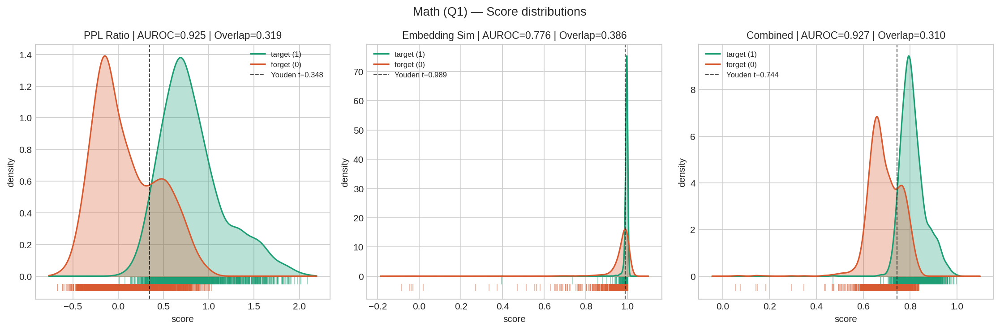

With the larger eval set, embedding is near-random; PPL and combined still show modest separation. Loosen or tighten `N_BINS_PER` / `LOWER` in `download.py` to trade eval size vs length-AUROC.

### Plot 2 — ROC curves

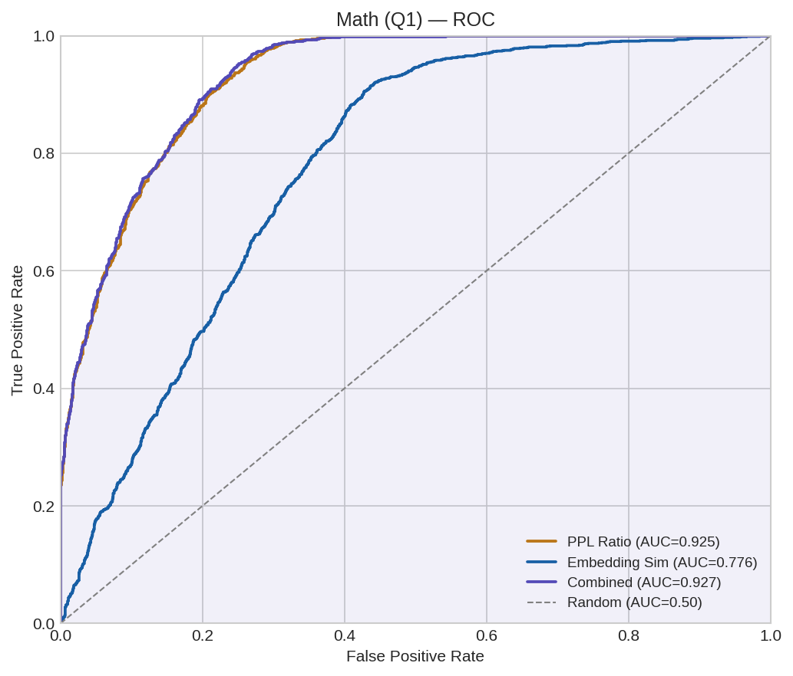

### Plot 3 — Precision–recall

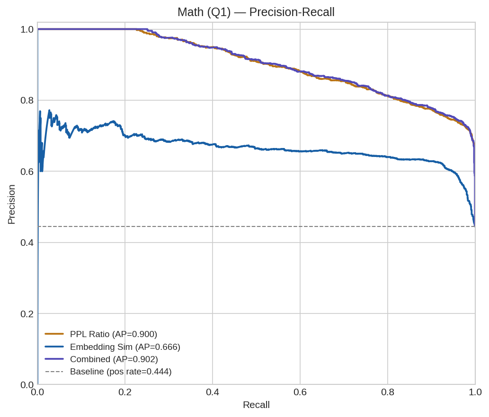

### Plot 4 — PPL vs embedding scatter

Each point is one eval row; marginal rug/KDE on axes.

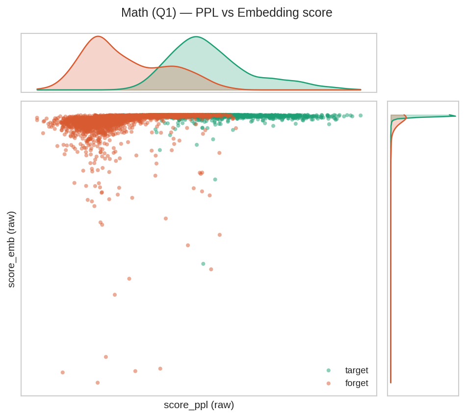

### Plot 5 — UMAP of LoRA embeddings

2D projection of mean-pooled LoRA last-layer states; convex hulls per class.

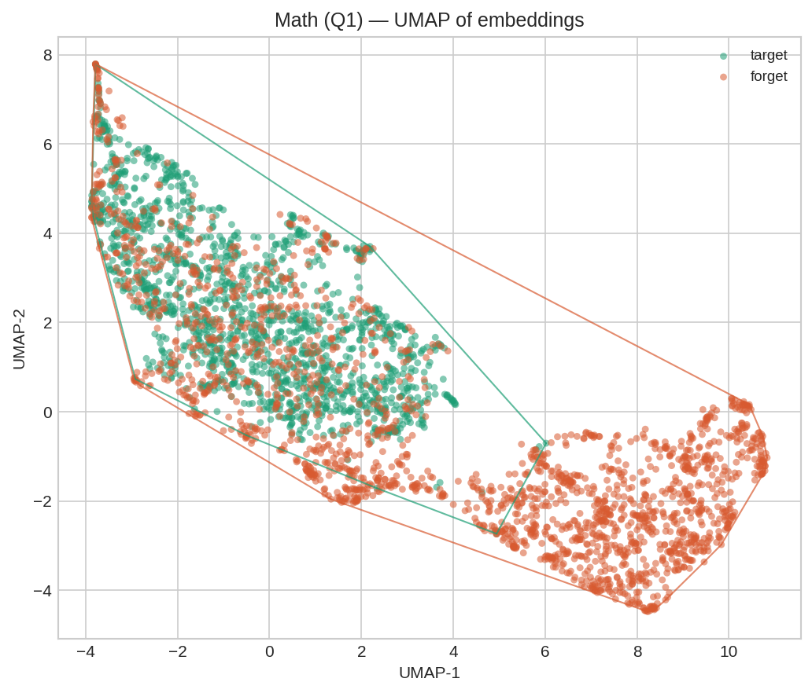

### Plot 6 — Combined threshold sweep

Precision, recall, and F1 vs threshold on the min-max combined score.

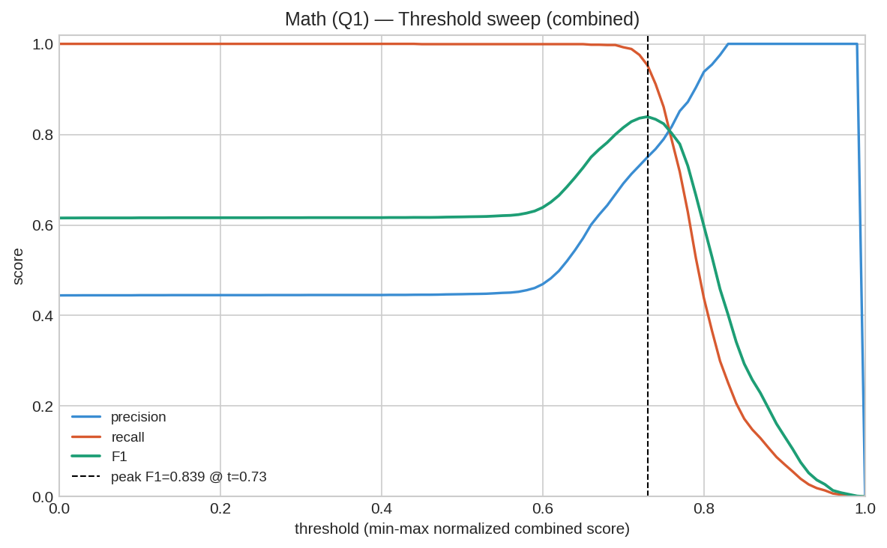

### Plot 7 — Layerwise activation drift

Top: mean cosine drift (base vs LoRA) per layer for target and forget. Bottom: Δ(target − forget) — where LoRA differentiated classes.

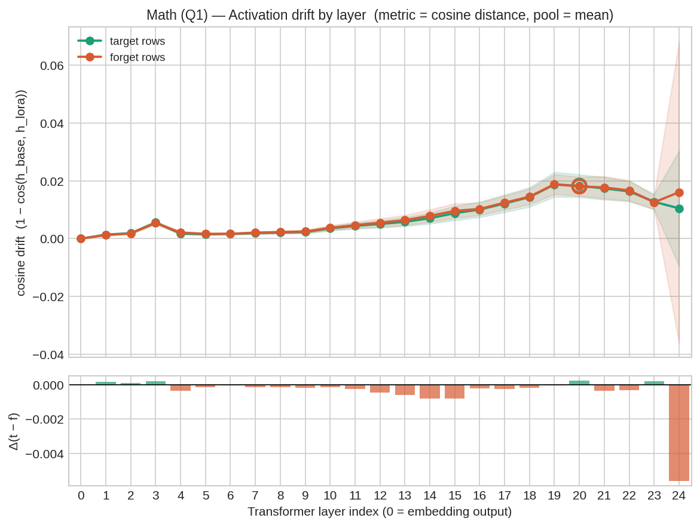

Plots for Q2–Q4 follow the same naming under `plots/q2_humaneval_vs_mbpp/`, `plots/q3_squad_vs_nq/`, `plots/q4_agnews_vs_reuters/`.

---

## Cross-quadrant summary

ROC curves for all four quadrants × three methods (from `plot_summary`):

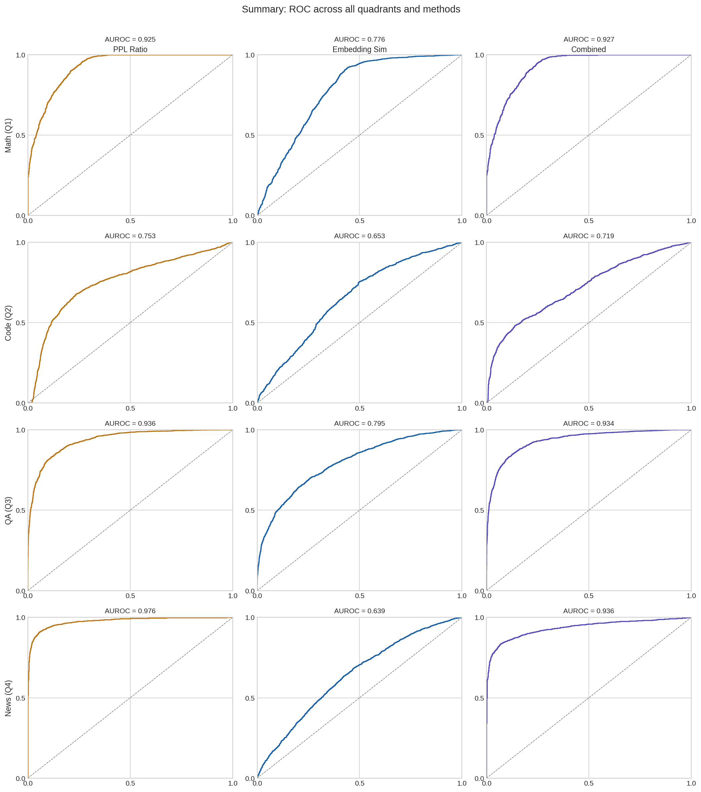

**AUROC by quadrant** (from `results/*_metrics.json` on the current checkpoints):

| Quadrant | PPL | Embedding | Combined |
|----------|-----|-----------|----------|
| Q1 Math | 0.645 | 0.528 | 0.678 |
| Q2 Code | 0.832 | 0.817 | **0.884** |
| Q3 QA | 0.807 | 0.811 | **0.875** |
| Q4 News | 0.786 | 0.621 | 0.741 |

Q2 and Q3 show the strongest combined AUROC. Q1 has the largest eval among the math/code pairs but weaker separation after relaxed length matching. Re-run `python download.py` then `experiments/run_identification.py` (delete `checkpoints/q{n}_*` to retrain LoRA) after changing data knobs.

---

## Configuration

| Knob | Default | Role |
|------|---------|------|
| `BASE_MODEL` | `openai-community/gpt2-medium` | Backbone + LoRA host |
| `MAX_SEQ_LEN` | `256` | Token truncation |
| `LORA_R` / `LORA_ALPHA` | `16` / `32` | Adapter capacity |
| `TRAIN_EPOCHS` | `3` | Training passes over train subset |
| `LR` | `2e-4` | AdamW |
| `SPLIT_RATIO` | `0.2` | Fraction of target used for LoRA |
| `SPLIT_SEED` | `42` | K-means + selection reproducibility |
| `PROBE_BATCH` | `16` | Hidden-state batch size |
| `PROBE_POOL` | `"mean"` | Token pooling (`mean` or `last`) |
| `P_RATIO` | `0.2` | Target fraction reserved as PU positives / reference (`make_pu_split`) |
| `MINK_FRAC` | `0.2` | Min-K++ fraction of most-surprising tokens averaged |
| `LIRA_N_SHADOWS` | `8` | Shadow LoRA adapters for LiRA |
| `LIRA_SHADOW_FRAC` | `0.5` | Target fraction each shadow trains on |
| `PU_SCORE_COLS` | `[ppl_ratio, minkpp, emb_cos, lira_lite]` | Overlap-score columns used as classifier features |
| `PU_HIDDEN` | `0` | nnPU head width (0 ⇒ linear; >0 ⇒ MLP) |
| `PU_MLP_HIDDEN` | `32` | Width of the `pu_static_mlp` baseline head |
| `PU_ROUNDS` / `PU_BUDGET` | `10` / `40` | Active rounds and per-round oracle-label cap (actual ≈ `0.06·|U_pool|`) |
| `PU_EPOCHS` / `PU_LR` | `200` / `1e-2` | nnPU refit schedule |
| `PU_PRIOR` | `known` | Positive prior π in U (`known` from split, or a float) |
| `PU_SEEDS` | `5` | Repeats for mean ± std in the comparison |
| `BASE_MODEL_OVERRIDE` (env) | — | Point `BASE_MODEL` at a local HF snapshot for offline runs |

Edit [`config.py`](config.py) for model and split settings. **Eval / Active-PU size** is controlled by `DATA_SCALE` and knobs in [`download.py`](download.py):

| Knob | `large` (default) | `small` | Effect |
|------|-------------------|---------|--------|
| `DATA_SCALE` | `large` | `small` | Env var selecting the profile |
| `TARGET_N` | 2500 / 2000 / 3000 / 3000 | 1000 / 500 / 1000 / 1000 | Max rows per class after matching |
| `N_BINS_PER` | 8 / 8 / 20 / 20 | 10 / 8 / 30 / 30 | More bins → lower length-AUROC, fewer rows |
| `RAW_CAP` (Q3/Q4) | 30 000 | 8 000 | Upstream rows before matching |
| Q1 forget pad | SVAMP + soft ASDiv (≤300) | SVAMP only | Soft mix; full ASDiv hurt the skyline |
| Q2 pads | HumanEval+CSN vs **MBPP only** | HumanEval vs MBPP | CSN on forget collapsed Q2 signal |

Active-PU budgets in `config.py`: `PU_ROUNDS=10`, `PU_BUDGET=40` (actual per-round budget = `min(PU_BUDGET, 0.06·|U_pool|)`).

Eval size ≈ `n_target + n_forget` with matched `n_target ≈ n_forget`. Length-only AUROC after matching should stay near 0.5 (Q3/Q4 ≈ 0.50; Q1/Q2 ≈ 0.50–0.56).

---

## Project layout

```
modelunlearning/
├── config.py
├── download.py
├── requirements.txt
├── experiments/
│   ├── run_identification.py      # identification benchmark
│   ├── run_overlap_scorers.py     # Active-PU Stage 2/8: overlap estimators + metrics
│   └── run_active_pu.py           # Active-PU Stage 3–8: nnPU + baselines, full comparison
├── src/
│   ├── data_loader.py             # load, split (incl. make_pu_split), audit
│   ├── sample_select.py           # active-learning selection
│   ├── hidden_states.py           # pooled hidden-state extraction
│   ├── lora_trainer.py
│   ├── scorer.py
│   ├── overlap_scorers.py         # PPL ratio, Min-K++, embedding, LiRA-lite/full
│   ├── shadow_lora.py             # shadow adapters for LiRA references
│   ├── active_pu.py               # nnPU + 6 acquisition strategies + PN/static/skyline baselines
│   ├── metrics.py
│   ├── probe.py                   # layerwise drift
│   └── plotting.py
├── data/
│   ├── raw/                       # per-dataset JSON exports
│   └── quadrants/q{n}_*/           # *_combined.json per pair
├── checkpoints/q{n}_*_r20_s42_e1/ # LoRA adapter + split_info.json
├── results/                       # metrics, audit, drift JSONs
└── plots/                         # per-quadrant PNGs + summary grid
```

**JSON artifacts per quadrant**

| File | Contents |
|------|----------|
| `results/{qid}_{name}_metrics.json` | Full metric dict per method |
| `results/{qid}_{name}_audit.json` | Leakage audit receipts + sample IDs |
| `results/{qid}_{name}_drift.json` | Per-layer drift means, Δ, L2 backup |
| `results/{qid}_{name}_overlap_scores.json` | Overlap-estimator metrics + 3-way split sizes |
| `results/{qid}_{name}_pu_features.npz` | Cached score columns + LoRA embedding for the P∪U pool |
| `results/{qid}_{name}_comparison.json` | All methods: per-metric mean ± std + label-efficiency curves |
| `results/comparison_summary.{json,md}` | Cross-quadrant AUROC master table |

---

## Leakage controls

Inflated AUROC from train/eval leakage is the main failure mode. Every run enforces:

1. **Deterministic split** — `SPLIT_SEED` fixes which target rows train vs held-out.
2. **`audit_split`** — zero overlap on row index, `(source, id)`, exact text, normalized text (printed before training).
3. **LoRA trains on `label=1` only** — enforced in `train_lora` and at the call site.
4. **PPL scores only the eval set** — no memorization of train texts in the metric.
5. **Embedding centroid from train subset only** — `(source, id)` disjoint from eval asserted in `compute_embedding_scores`.
6. **Checkpoint names encode split** — `r{ratio}_s{seed}_e{epochs}`; `split_info.json` lists trained keys.
7. **Base model has no adapter** — asserted before PPL scoring.

---

## Length matching (`download.py`)

Without controls, pairs like SST-2 vs MBPP made length alone near-perfect for classification. The current pipeline:

- Truncates to `TRUNC[qid]`, drops below `LOWER[qid]`.
- Keeps only the shared length band between classes.
- Samples equal counts per narrow bin inside that band.

Typical **length-only AUROC** after matching: ≈ 0.50 ± 0.02 (Q3/Q4); Q1/Q2 may reach ~0.55 when bins are coarser for larger eval sets. `download.py` prints the value for each quadrant at the end of a data build.

---

## Caveats

- **Retrain after scaling** — changing `DATA_SCALE` or `download.py` invalidates LoRA checkpoints, shadows, and `*_pu_features.npz`. Delete them before re-running the pipeline.
- **Q1 length trade-off** — GSM8K answers are often near the 200-char cap while SVAMP/ASDiv are shorter; tighter bins cut size, looser bins raise length-AUROC (~0.55). Prefer size with a printed length-AUROC check over forcing TARGET_N.
- **Q2 source pads** — under `large`, HumanEval is padded with CodeSearchNet Python (target) and MBPP with a *disjoint* CSN slice (forget). Canonical pair name stays `humaneval_vs_mbpp`; inspect `source` fields in the JSON if you need per-source breakdowns.
- **Template residue** — Length is matched; dataset-specific formatting (answer markers, code style, QA spans) may still differ. Inspect `*_audit.json` sample rows if AUROC looks unexpected.
- **Membership framing** — LoRA is optimized for the target distribution. The 80/20 split tests generalization beyond the train subset, not cold membership on an unrelated domain.
- **Q4 forget style** — XSum summaries vs AG News snippets; length is controlled but forget text is abstractive summary prose.
- **Runtime** — `DATA_SCALE=large` makes identification, LiRA shadows, and feature extraction substantially slower (especially Q3/Q4). Plan for multi-hour CPU runs or use CUDA.

---

## Dependencies

See [`requirements.txt`](requirements.txt): `torch`, `transformers`, `peft`, `scikit-learn`, `scipy`, `matplotlib`, `seaborn`, `umap-learn`, `pandas`, `numpy`, `tqdm`. Dataset download additionally uses `datasets` (installed when running `download.py`).
